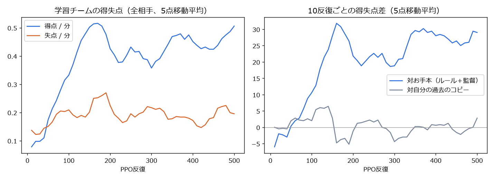

# 四足ロボットの2対2フットサル：LLM監督のお手本から学び、選手だけの自己対戦で強くする

Physical AI 応用1講座 最終課題（優秀賞向けの追加作品）。アカウント：**Rick0218**

## 概要

Genesis上で、Unitree Go2 4体（各チーム キーパー1体＋フィールドプレーヤー1体）がボールを奪い合う2対2のフットサルを作った。
ロボットの判断は3層に分けている。

| 層 | 入力 → 出力 | AI |
|---|---|---|
| 監督 | 日本語の作戦指示 → 作戦パラメータ（攻撃性・キーパーの位置・速さ） | ローカルLLM（Ollama, qwen2.5:7b-instruct、JSON schemaで出力を制約） |
| 戦術（上位方策） | 自分・味方・相手2体・ボールの位置と速度 → 速度指令（vx, vy, wz）を0.1秒ごと | ①ルールのお手本 → ②模倣学習 → ③選手だけの自己対戦で強化学習（PPO） |
| 足まわり（下位方策） | 速度指令 → 12関節の目標角を50Hz | 強化学習（PPO）。速度追従の方策を、横移動の拡大と外乱付きで追加学習 |

提出動画：https://youtu.be/w7fTLleIA-0（YouTube）／ [videos/futsal_submission.mp4](videos/futsal_submission.mp4)（等速）

レポート：[docs/report.md](docs/report.md)（Markdown）／ [docs/report.pdf](docs/report.pdf)（PDF）

## 結果

各組み合わせ256試合（1試合60秒、両チームのサイドを入れ替えて128試合ずつ）。
数値の元データは [results/eval.json](results/eval.json)（`python futsal/summarize_results.py` で同じ表を出せる。表と元データの一致はテストで確認している）。

| 対戦 | 勝ち | 引き分け | 負け | 得点 − 失点 | 転倒（自 / 相手） |
|---|---|---|---|---|---|
| **強化学習後** 対 お手本（ルール＋監督） | **110** | 132 | 14 | **140 − 21** | 101 / 250 |
| 模倣学習のみ 対 お手本 | 20 | 198 | 38 | 24 − 42 | 93 / 147 |
| **強化学習後** 対 模倣学習のみ | **89** | 162 | 5 | **103 − 7** | 84 / 157 |
| お手本 対 お手本（確認用） | 46 | 163 | 47 | 61 − 58 | 251 / 231 |

- 模倣学習だけでは、お手本にやや劣る（得点24、失点42）。選手だけの強化学習を500反復かけると、お手本に110勝14敗、得点はお手本の6.7倍になった。
- 強化学習後のチームは転倒も少ない（101回、お手本は250回）。ぶつかり合いを避ける動き方を覚えたと考えられる。
- 「お手本 対 お手本」はほぼ互角（46勝47敗）で、サイドの有利不利はない。



## 流れ

1. **足まわりの追加学習**（`locomotion/go2_soccer_loco_train.py`）：同じ講座の課題で作ったGo2の速度追従方策（go2-cmd、800反復、`models/go2-cmd`）を初期値に、横移動を ±0.3 → ±0.6 m/s、旋回を ±1.0 → ±1.5 rad/s に広げ、3秒ごとにランダムで体を押す外乱を入れて600反復（1024並列、約12分）。
2. **監督**（`futsal/coach.py`）：日本語の作戦指示24種をqwen2.5:7bで作戦パラメータに変換して保存した（1件4〜7秒）。結果は [tactics.json](futsal/tactics.json)。
3. **お手本の試合**（`futsal/collect_bc.py`）：作戦パラメータに従うルールベースの戦術（`futsal_teacher.py`）同士で、256試合を並列に回した（1,024試合、シミュレーション時間で約17時間、実時間8分）。3割のロボットにはノイズを加えた指令を実行させ、立て直しの場面もデータに入れた（ラベルは常にノイズなしのお手本）。
4. **模倣学習**：お手本の「状況 → 速度指令」246万組で上位方策（MLP 23-256-128-3）を教師あり学習した（検証MSE 0.168 → 0.064）。
5. **選手だけの強化学習**（`futsal/rl_train.py`）：模倣学習の方策を初期値にPPO（192試合並列、500反復、約45分）。
   - 監督もルールも使わない。学習チーム2体が1つの方策を共有し、役割（キーパー／選手）は入力で区別する。
   - 相手は試合ごとに、自分の過去のコピー（50反復ごとに更新）かお手本を半々で選ぶ。
   - 報酬：得点 +10、失点 −10、ボールを相手ゴール方向へ運んだ距離 ×2、自チームの転倒 −1。
   - 最初の20反復は方策を固定して価値関数だけを学習した。
6. **評価**（`futsal/eval_matches.py`）：上の表。

## 仕組みの要点

- **同じ方策でどちらのサイドも戦える**：観測はすべて「自チームが+x方向に攻める」座標系に変換し、赤チームは左右・前後を反転して入力する。
- **フットサルのルール**：コート6 m × 4 m、ゴール幅1.4 m、壁あり。得点・60秒経過で終了。ボールが8秒止まったら中央付近に置き直す。60度以上傾いたロボットは自陣に戻して起こし直す（転倒として数える）。
- **監督の指示の反映**：作戦パラメータは上位方策の入力にも含まれる。お手本は作戦に従って動きを変える（攻撃性が低いと自陣に下がる、キーパーが前に出る、など）。

## 限界と正直な注意

- 上位方策の行動は速度指令だけで、「蹴る」動作はない。ボールは体で押して運ぶ。
- 引き分けが多い（0−0が多い）。1分間の試合は短く、ゴールも小さいため。
- **強化学習後のキーパーはゴールを離れる**。動画の試合では、自陣ゴール前にいた時間が6%だった（お手本は44〜100%）。報酬が得点・失点・ボールの前進だけなので、キーパーの役割を守らず、2体目の守備者のように動く。役割ごとの位置の報酬が必要（`futsal/keeper_pos.py` で計測）。
- 監督LLMの解釈には誤りがある。「ゴール前を固めて、キーパーは下がれ」を keeper_depth = 1.0（前に出る）と変換した。24件中、明らかな誤りは1件。
- 強化学習は途中（210反復目）でWSLのメモリ不足により止まった。189反復目のチェックポイント（方策・価値関数・最適化器）から再開している。学習曲線の190〜210反復は再開後の値。
- 強化学習で強くなった相手は「お手本」と「自分の過去」だけで、未知の戦術への強さは検証していない。また学習した方策は監督の作戦パラメータをほぼ無視している可能性があり、作戦による動きの変化は確認していない。
- シミュレーションのみ。実機への転移は扱っていない。

## リポジトリ構成

```
futsal/        フットサル環境・お手本・監督・模倣学習・強化学習・評価・動画化
  futsal_env.py      2対2の環境（Genesis）。チーム座標系への変換、得点・転倒・リセットの処理
  futsal_teacher.py  ルールベースのお手本（作戦パラメータで動きが変わる）
  coach.py           監督：日本語の指示 → 作戦パラメータ（Ollama）。結果は tactics.json
  collect_bc.py      お手本の試合を集めて模倣学習（MLP 23-256-128-3）
  rl_train.py        選手だけの自己対戦PPO（rsl_rl）
  eval_matches.py    対戦評価（勝ち・引き分け・負けの集計は match_stats.py）
  summarize_results.py  保存済みの結果ファイルから結果表を出す（GPU不要）
  record_match.py / render_replay.py / compose_video.py / futsal_video.py  試合の記録と動画化
  plot_progress.py / keeper_pos.py / goals.py / frame.py / sheet.py  図・解析の小道具
locomotion/    Go2の足まわり（速度追従）の学習。go2_env.py・go2_train.py は Genesis examples
models/        学習済みモデル（go2-cmd、go2-soccer、bc、futsal-rl）と学習記録
results/       評価結果 eval.json、学習曲線、学習ログ
videos/        提出動画とその素材
docs/          レポート（report.md、report.pdf、図）
tests/         CPUだけで動くテスト（pytest）
```

## 動かすのに必要なもの

| 作業 | GPU | Genesis | その他 |
|---|---|---|---|
| 足まわりの学習・お手本の試合・模倣学習・強化学習・評価・試合の記録と描画 | 要（CUDA） | 要 | torch、rsl-rl-lib、tensordict |
| 監督（`coach.py`） | 不要 | 不要 | Ollama + qwen2.5:7b-instruct |
| 動画の合成（`compose_video.py`）・コマ抜き出し | 不要 | 不要 | PyAV、Pillow、NumPy |
| 学習曲線の図（`plot_progress.py`） | 不要 | 不要 | pandas、matplotlib |
| 結果表の再表示（`summarize_results.py`）・テスト（`pytest`） | 不要 | 不要 | 標準ライブラリ + pytest（torchがあればテストが増える） |

### どこでも動くもの（GPU・シミュレータ不要）

リポジトリの一番上で実行する。

```bash
pip install -r requirements-dev.txt                 # pytest のみ
python futsal/summarize_results.py                  # results/eval.json などから結果表を出し、数値の整合性を確認
python -m pytest -q -rs                             # 集計・README の数値・（torch があれば）観測とお手本の対称性など
python futsal/plot_progress.py models/futsal-rl/progress.csv /tmp/rl_progress.png   # 学習曲線（pandas, matplotlib）
```

- `summarize_results.py` と `pytest` は Python 3.11 / 3.13 で確認済み（GitHub Actions でも同じものを実行）。
- `pip install torch`（CPU版でよい）を入れると、観測・お手本の左右対称性、学習済み方策の読み込み、強化学習の報酬のテストも動く。Genesis は入っていなければテスト内で差し替える。
- `plot_progress.py` は `models/futsal-rl/progress.csv` から `results/rl_progress.png` と同じ曲線を描けることを確認済み（日本語フォントは WSL の Windows フォントか Noto CJK を使う）。

### 学習・評価の再現（GPU + Genesis が必要）

作者の環境：WSL2 Ubuntu、RTX 4060 Laptop 8GB、Python 3.11、torch 2.11.0+cu128、genesis-world 1.4.5、rsl-rl-lib 5.5.2。

以下は作者の環境で実行したコマンドで、この整理の際には再実行していない（GPU・シミュレータがないため未検証）。
`futsal/` の中で実行する（`tactics.json` を相対パスで読むため）。出力は `futsal/logs/`、評価結果は `futsal/results/eval.json` に書かれる（リポジトリ直下の `results/` は提出時の結果）。

```bash
cd futsal
python ../locomotion/go2_soccer_loco_train.py -e go2-soccer             # 足まわり（約12分）
python coach.py --build tactics.json                                     # 監督（要 Ollama + qwen2.5:7b-instruct）
python collect_bc.py --ckpt ../models/go2-soccer/model_1398.pt --n 256 --seconds 240
python rl_train.py --ckpt ../models/go2-soccer/model_1398.pt --bc ../models/bc/bc_policy.pt -n 192 --iters 500
python eval_matches.py --ckpt ../models/go2-soccer/model_1398.pt --n 128 \
  --pair "rl=../models/futsal-rl/policy_500.pt:teacher=teacher"
```

- 表の4組を出すには `--pair` を4つ並べる：`rl=../models/futsal-rl/policy_500.pt:teacher=teacher`、`bc=../models/bc/bc_policy.pt:teacher=teacher`、`rl=../models/futsal-rl/policy_500.pt:bc=../models/bc/bc_policy.pt`、`teacher=teacher:teacher=teacher`。
- 強化学習は本番では210反復目で止まり、`--resume logs/futsal-rl/model_189.pt --start-iter 190 --opponent logs/futsal-rl/policy_200.pt` で再開した（[models/futsal-rl/config.json](models/futsal-rl/config.json) に記録された値）。
- 試合の記録と動画化：`record_match.py` → `render_replay.py` → `compose_video.py plan_final.json out.mp4`（各ファイル先頭の usage を参照）。

## 出典・クレジット

- `locomotion/go2_env.py`、`go2_train.py`：Genesis v1.4.5 の examples/locomotion（無改変）。
- `locomotion/go2_cmd_train.py`：同じ課題の補足実験で作った速度追従の拡張（Genesis examplesを元に作成）。
- それ以外のフットサル環境・お手本・監督・学習・評価・動画化のコードは本課題で作成した（Claudeによる実装支援を含む）。
- Genesis、rsl_rl（PPO）、Unitree Go2モデル、Ollama、Qwen2.5を使用した。
