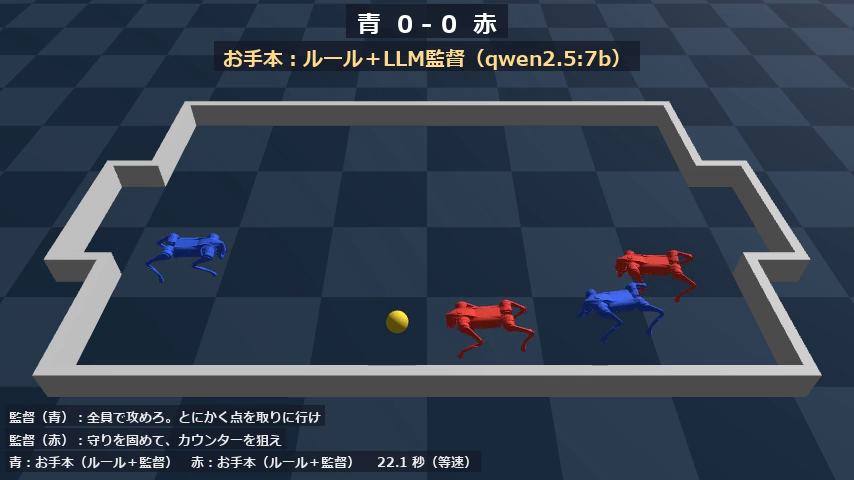
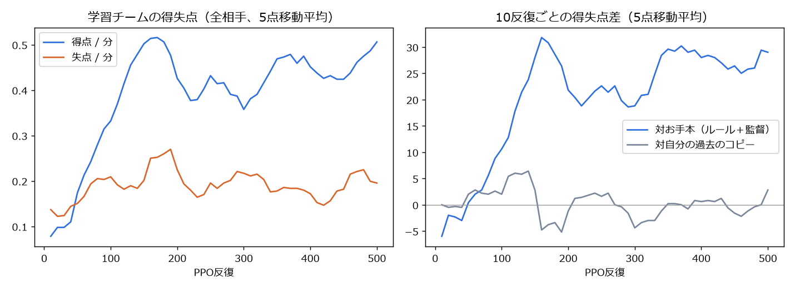
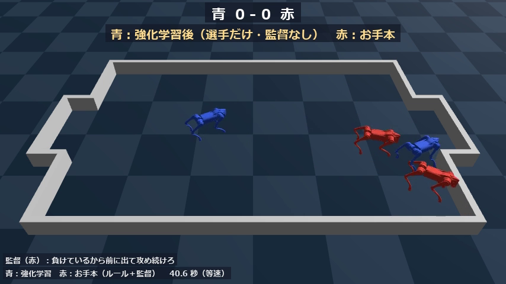

# 四足ロボットの2対2フットサル：LLM監督のお手本から学び、選手だけの自己対戦で強くする

Physical AI 応用1講座 最終課題　説明資料（優秀賞向けの追加作品）
アカウント：**Rick0218**

> 数値はすべて、収録した学習ログ・評価結果（`results/`、`models/`）からの転記である。動画はシミュレーションの等速再生。

## 1. 概要と目的

Genesis上で、Unitree Go2 4体による2対2のフットサルを作った。各チームはキーパー1体とフィールドプレーヤー1体で、ボールを奪い合ってゴールを狙う。

目的は、人間の監督が言葉で出す作戦と、ロボット自身が試合経験から学ぶ強さを、1つの仕組みでつなぐことである。そのために次の順で学習させた。

1. 監督（LLM）の日本語の指示に従うお手本の試合を大量に回す。
2. お手本を模倣学習する。
3. 監督もルールも使わない「選手だけ」の自己対戦で強化学習し、お手本より強くする。

AIは3か所で使っている。

- ローカルLLMによる作戦の解釈（推論）
- 上位方策の模倣学習と強化学習
- 下位の歩行方策の強化学習

### 1.1 結果のまとめ

| 対戦（各256試合、1試合60秒） | 勝ち | 引き分け | 負け | 得点 − 失点 |
|---|---|---|---|---|
| **強化学習後** 対 お手本（ルール＋監督） | **110** | 132 | 14 | **140 − 21** |
| 模倣学習のみ 対 お手本 | 20 | 198 | 38 | 24 − 42 |
| **強化学習後** 対 模倣学習のみ | **89** | 162 | 5 | **103 − 7** |
| お手本 対 お手本（確認用） | 46 | 163 | 47 | 61 − 58 |

模倣学習だけではお手本にやや劣った。選手だけの強化学習を加えると、お手本に110勝14敗となり、得点はお手本の約6.7倍になった。

## 2. システム構成

| 層 | 入力 → 出力 | AI |
|---|---|---|
| 監督 | 日本語の作戦指示 → 作戦パラメータ3つ（攻撃性・キーパーの位置・速さ、各0〜1） | Ollama上のqwen2.5:7b-instruct。JSON schemaで出力を制約 |
| 戦術（上位方策） | 自分・味方・相手2体・ボールの位置と速度、役割、作戦（23次元）→ 速度指令（vx, vy, wz）を0.1秒ごと | ルールのお手本 → 模倣学習 → 強化学習（PPO） |
| 足まわり（下位方策） | 速度指令と関節の状態（45次元）→ 12関節の目標角を50Hz | 強化学習（PPO） |

- **コート**：6 m × 4 m、ゴール幅1.4 m、周囲に壁。
- **終了と得点**：ボールがゴールに入ると得点し、キックオフからやり直す。60秒で試合終了。
- **やり直しの規則**
  - ボールが8秒止まったら、中央付近に置き直す。
  - 60度以上傾いたロボットは自陣で起こし直し、転倒として数える。
- **左右反転**：観測はすべて「自チームが+x方向に攻める」座標系で表す。赤チームは前後・左右を反転して入力するので、同じ方策でどちらのサイドも戦える。

## 3. 学習の流れと工夫

### 3.1 足まわり：サッカー向けの追加学習

同じ講座の課題で作ったGo2の速度追従方策（go2-cmd、800反復）を初期値に、次の条件で600反復追加学習した（1024並列、約12分）。

- 横移動の範囲を ±0.3 → ±0.6 m/s に広げた（キーパーの横移動のため）。
- 旋回の範囲を ±1.0 → ±1.5 rad/s に広げた。
- 3秒ごとに半数のロボットの体を最大0.6 m/sで押す外乱を入れた（接触で倒れないように）。
- 終了判定の傾きを10度から20度に緩めた。

### 3.2 監督：日本語の作戦 → 作戦パラメータ

作戦パラメータは次の3つで、それぞれお手本の動きに対応する。

- attack（攻撃性）：低いと、ボールが相手陣にあるときに選手が自陣へ下がる。
- keeper_depth（キーパーの位置）：高いと、キーパーがゴールから最大0.9 m前に出る。
- press（速さ）：選手の速さが0.6〜1.2 m/sの範囲で変わる。

日本語の指示24種を変換して保存した（1件4〜7秒）。例を挙げる。

- 「守りを固めて、カウンターを狙え」→ attack 0.1、keeper_depth 0.4、press 0.3
- 「全速力でボールを追いかけろ」→ press 1.0

明らかな誤りが1件あった。「ゴール前を固めて、キーパーは下がれ」を keeper_depth 1.0（前に出る）と変換した。

### 3.3 お手本の試合と模倣学習

**お手本の戦術**（ルールベース）

- 選手：ボールと相手ゴールを結ぶ線の後ろへ回り込み、ボールを押して進む。ボールより前にいるときは、横から回り込む。
- キーパー：ゴール前の線上で、ボールの横位置（とその速度）に合わせて横移動する。ボールが近づいたら前に出てクリアする。

**データ集め**

- 監督の作戦をチームごとに乱数で選び、256試合を並列に回した。合計1,024試合、シミュレーション時間で約17時間、実時間は8分。
- 3割のロボットにはノイズを加えた指令を実行させ、崩れた状況からの立て直しもデータに含めた。ラベルは常にノイズなしのお手本である。

**模倣学習**

- 得られた246万組の「状況 → 速度指令」で、MLP（23-256-128-3）を教師あり学習した。
- 検証データの二乗誤差は0.168から0.064に下がった。

### 3.4 選手だけの自己対戦で強化学習

模倣学習の方策を初期値に、PPOで学習した（192試合並列、500反復）。

- **監督なし・ルールなし**：学習チームでは、監督もルールも使わない。2体で1つの方策を共有し、役割は入力で区別する。
- **相手**：試合ごとに、自分の過去のコピー（50反復ごとに更新）かお手本を半々で選んだ。
- **報酬**：得点 +10、失点 −10、ボールを相手ゴール方向へ運んだ距離 ×2、自チームの転倒 −1。
- **初期化の工夫**：最初の20反復は方策を固定し、価値関数だけを学習した。模倣学習で得た動きを、学習していない価値関数で崩さないためである。

学習曲線を見ると、お手本との得失点差（10反復あたり）は、最初はやや負け越していた（−6前後）。150反復目までに+30前後へ上がり、その後も維持した。自分の過去のコピーとの対戦はほぼ互角のまま推移しており、自己対戦として正常に競り合っている。

## 4. 結果の考察

- **強化学習で何が変わったか**：模倣学習だけのチームは、お手本に得点24・失点42と劣った。模倣学習は、お手本の平均的な動きしか再現できないためと考えられる。強化学習後は、得点140・失点21と大きく上回った。
- **転倒が減った**：強化学習後のチームの転倒は101回で、お手本の250回より大幅に少ない。転倒の罰を通じて、ぶつかり合いを避ける動きを覚えたと考えられる。
- **引き分けが多い**：お手本同士でも256試合中163試合が引き分けだった。1分間の試合は短く、ゴールも小さいためである。
- **キーパーがゴールを離れた**：動画の試合（60秒）でキーパーの位置を測った。強化学習後のキーパーが自陣ゴール前（ゴールラインから1 m以内、ゴール中心から左右1 m以内）にいた時間は6%だった。平均位置はゴールラインから約1.6 m前、横に約1 mずれている。お手本のキーパーは同じ範囲に44〜100%いた。報酬は得点・失点・ボールの前進だけで、役割は観測の入力にすぎない。そのため強化学習は「キーパーらしさ」を守らず、2体目の守備者のような位置取りを選んだ。失点は少ないが、フットサルの役割としてはキーパーを放棄している。役割に応じた位置の報酬や制約が必要である。

## 5. 限界と今後

- **蹴る動作がない**：上位方策の行動は速度指令だけで、ボールは体で押して運ぶ。
- **作戦の効き方は未検証**：強化学習後の方策が、監督の作戦パラメータに従って動きを変えるかは確認していない。報酬が作戦と無関係なので、無視している可能性がある。今後は「作戦に沿った行動」にも報酬を与え、学習後も言葉で戦い方を変えられるようにしたい。
- **相手の多様性が少ない**：強化学習の相手は「お手本」と「自分の過去」だけで、未知の戦術への強さは検証していない。
- **学習の中断と再開**：強化学習は途中（210反復目）でWSLのメモリ不足により止まった。189反復目の保存点（方策・価値関数・最適化器）から再開しており、学習曲線の190〜210反復は再開後の値である。
- **評価の範囲**：シミュレーションのみで、実機への転移は扱っていない。

## 6. コードとクレジット

- リポジトリ：https://github.com/rick0218gray-sketch/physical-AI1-futsal
- コード、学習済みモデル（下位1個、模倣学習、強化学習）、評価結果、動画をリポジトリに収録した。
- `locomotion/go2_env.py` と `go2_train.py` は、Genesis v1.4.5 の examples/locomotion（無改変）である。
- フットサルの環境・お手本・監督・学習・評価・動画化のコードは本課題で作成した。実装にはClaudeの支援を受けた。
- 使用した基盤：Genesis、rsl_rl（PPO）、Unitree Go2モデル、Ollama、Qwen2.5。
